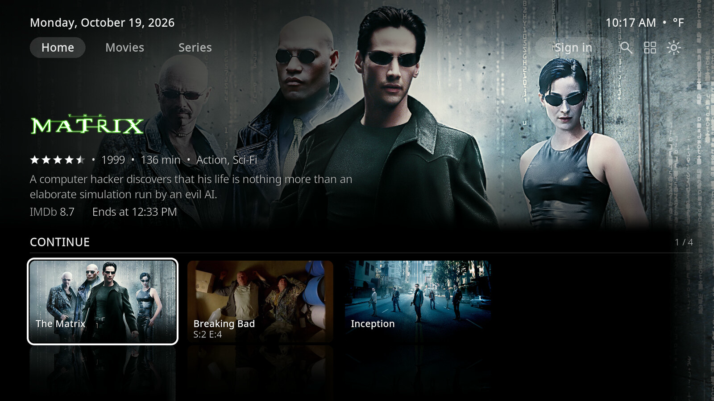
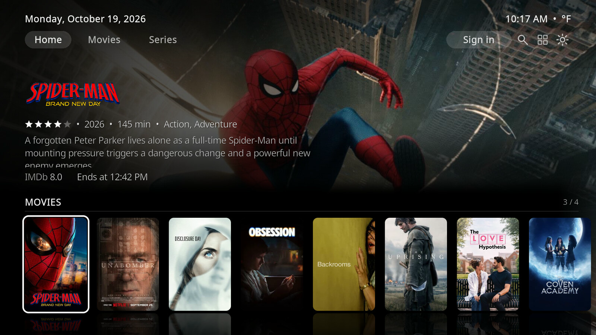
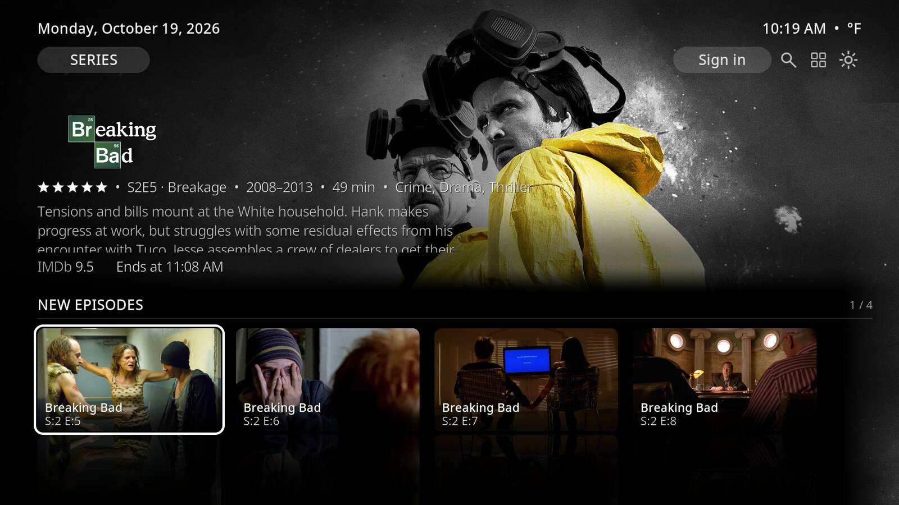
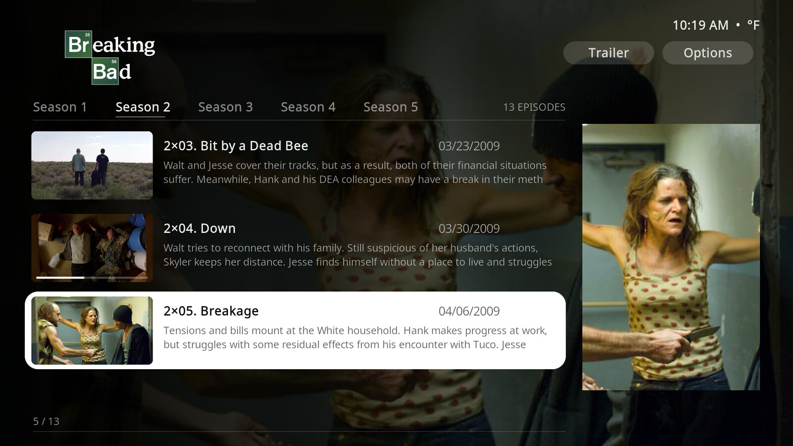
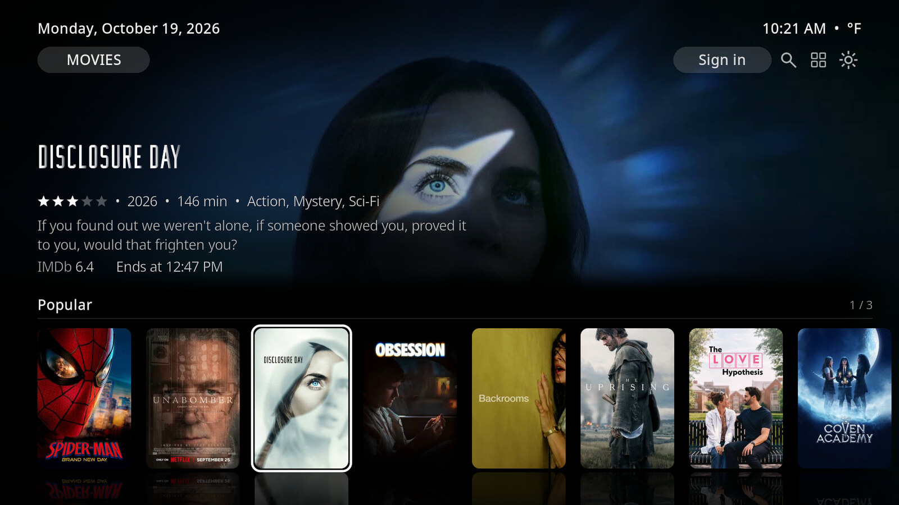
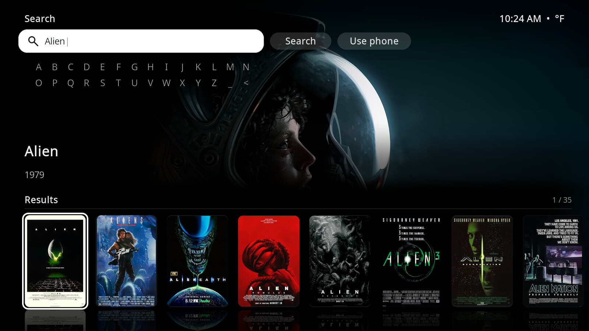
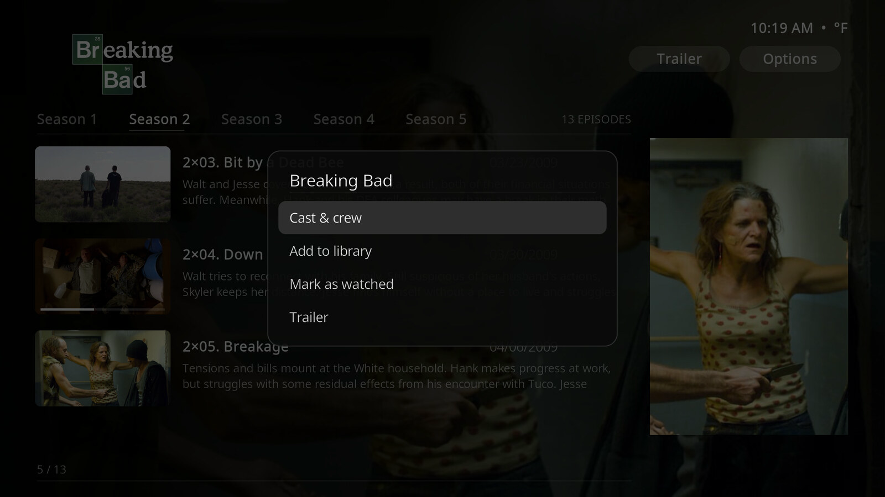
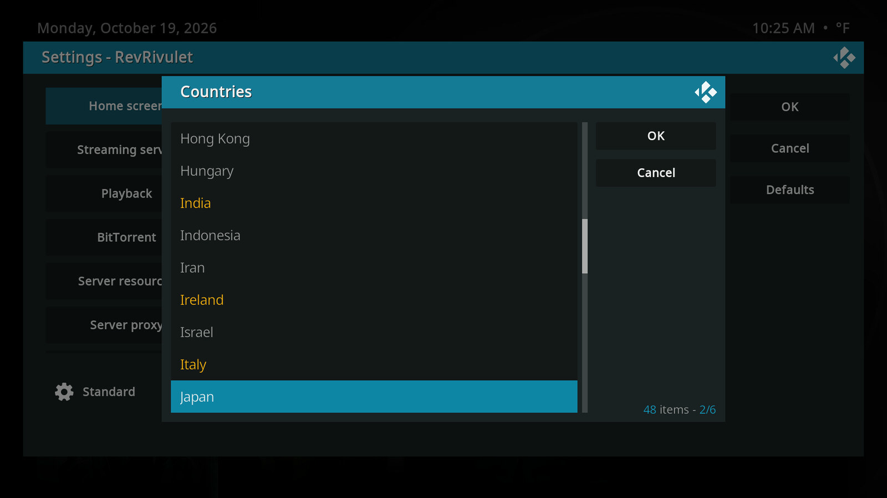

  

  # RevRivulet

  **A fresh, full-screen look for Rivulet on Kodi, built to be used with just your TV remote.**

  

---

> **Credits**
> - RevRivulet is a fork of [Rivulet](https://github.com/rivulet-kodi/plugin.video.rivulet)
>   by [M0Rf30](https://github.com/M0Rf30). All credit for the original add-on goes to them.
>   Licensed MIT (see [LICENSE](LICENSE)).
> - Look and feel inspired by [Arctic Fuse 3](https://github.com/jurialmunkey/skin.arctic.fuse.3)
>   by [jurialmunkey](https://github.com/jurialmunkey).
> - Built with help from AI coding tools. Every change is tested on CoreELEC/Kodi and maintained by me (TheGildedGoo).

RevRivulet installs next to official Rivulet, so you can keep both and use
whichever you like.

## What RevRivulet adds

Everything works with the remote. No typing needed.

**A new look** (turn it on in Settings → Home → New look)
- Big full-screen artwork with the title's logo, rating, runtime and when it ends.
- The same clean look on Home, Movies, Series, lists and search.
- A proper episode page with pictures, air dates and watched ticks.

**Home and browsing**
- Continue watching, your Library and New Episodes right on Home.
- Jump from an episode to its series, browse by decade, and hide countries or languages you don't want.
- Lists from streaming services now open and play properly.

**Search**
- Everything on one page: pick letters with the remote or type on your phone.
- Results show up as they arrive instead of waiting for the slowest source.

**Playback**
- Pick up where you left off, with progress synced to your Stremio account.
- Watch trailers without leaving the screen.

**Look and feel**
- Dark, rounded menus and pop-ups with a calm grey style.
- A "Refresh cached data" button for when artwork looks out of date.

## Screenshots

Captured on Kodi 21 at 1080p with the new look turned on.

|  |  |
| :---: | :---: |
| **Home — Continue** | **Home — catalog rows** |

|  |  |
| :---: | :---: |
| **Series — New Episodes** | **Episode page** |

|  |  |
| :---: | :---: |
| **Movies** | **One-page search** |

|  |  |
| :---: | :---: |
| **Dark, rounded menus** | **Country and language filter** |

## Install

1. In Kodi, go to **Settings → File manager → Add source**. Enter
   `https://thegildedgoo.github.io/plugin.video.rivulet/` and name it `RevRivulet`.
2. Go to **Settings → Add-ons → Install from zip file → RevRivulet** and pick
   `repository.revrivulet.zip`. (If Kodi asks, allow unknown sources.)
3. Go to **Install from repository → RevRivulet Repository → RevRivulet** and install it.
4. Open **RevRivulet** from your add-ons. To get the new look, turn on
   **Settings → Home → New look**.

Kodi will keep RevRivulet up to date on its own. Official Rivulet stays
installed and untouched.

## For developers / technical details

How it works, the streaming server, settings, building and testing are all in
[docs/TECHNICAL.md](docs/TECHNICAL.md).

---

  Based on <a href="https://github.com/rivulet-kodi/plugin.video.rivulet">Rivulet</a> by <a href="https://github.com/M0Rf30">M0Rf30</a>. Look and feel inspired by <a href="https://github.com/jurialmunkey/skin.arctic.fuse.3">Arctic Fuse 3</a> by <a href="https://github.com/jurialmunkey">jurialmunkey</a>. Built with help from AI coding tools; tested on CoreELEC/Kodi and maintained by TheGildedGoo. Licensed under <a href="LICENSE">MIT</a>. Not affiliated with Stremio.

